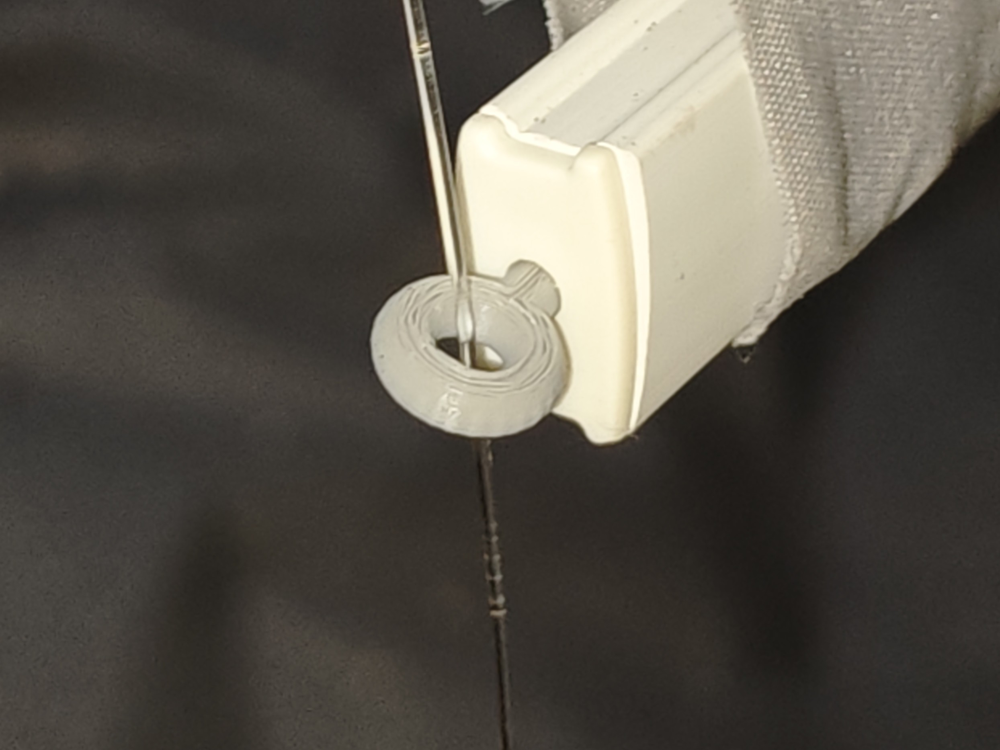
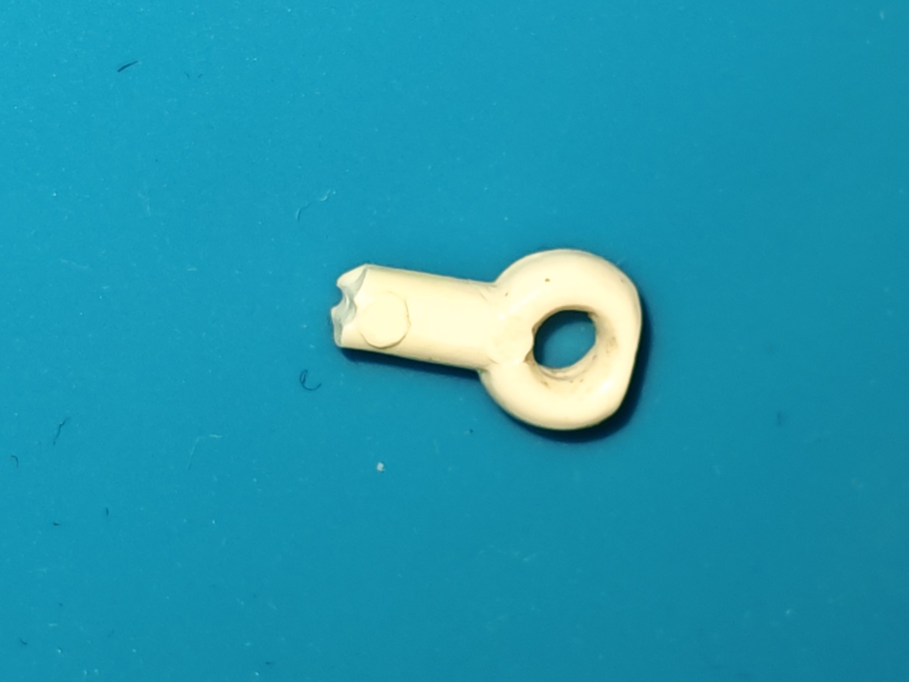
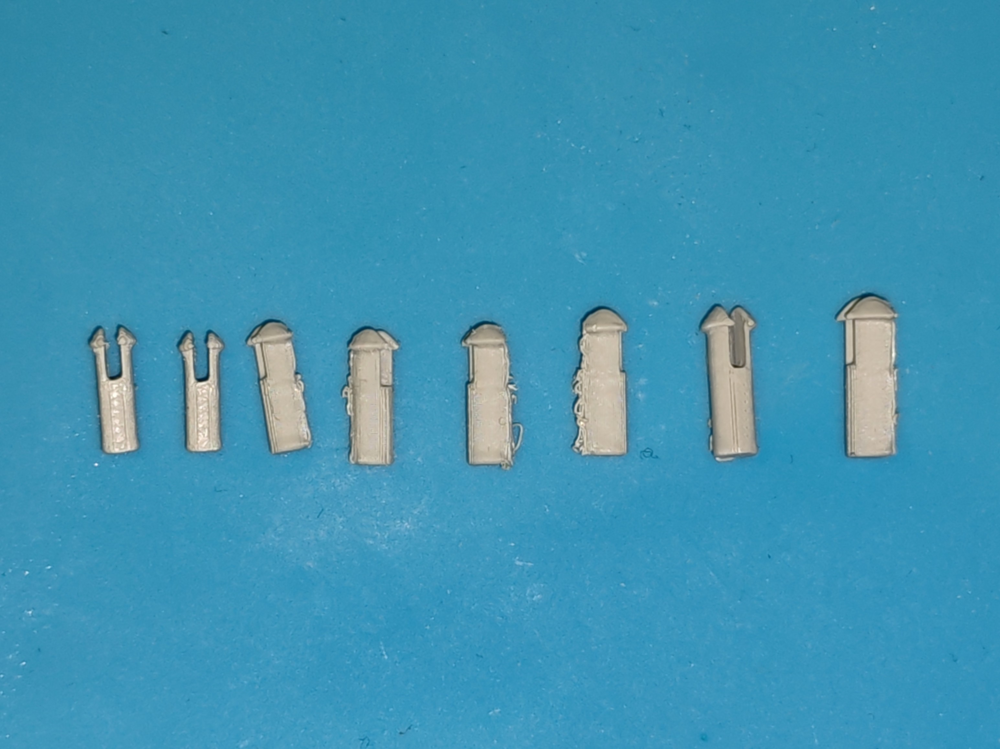
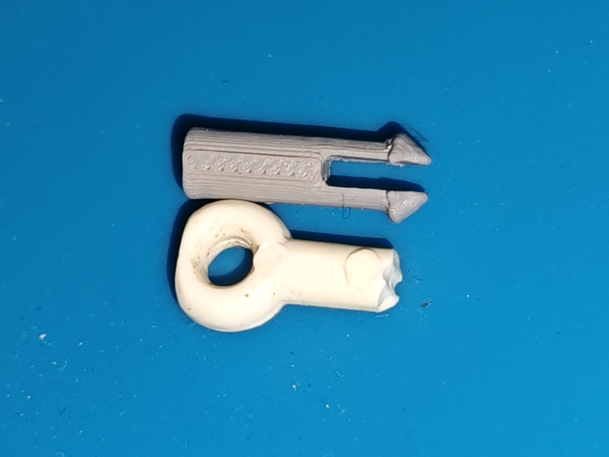
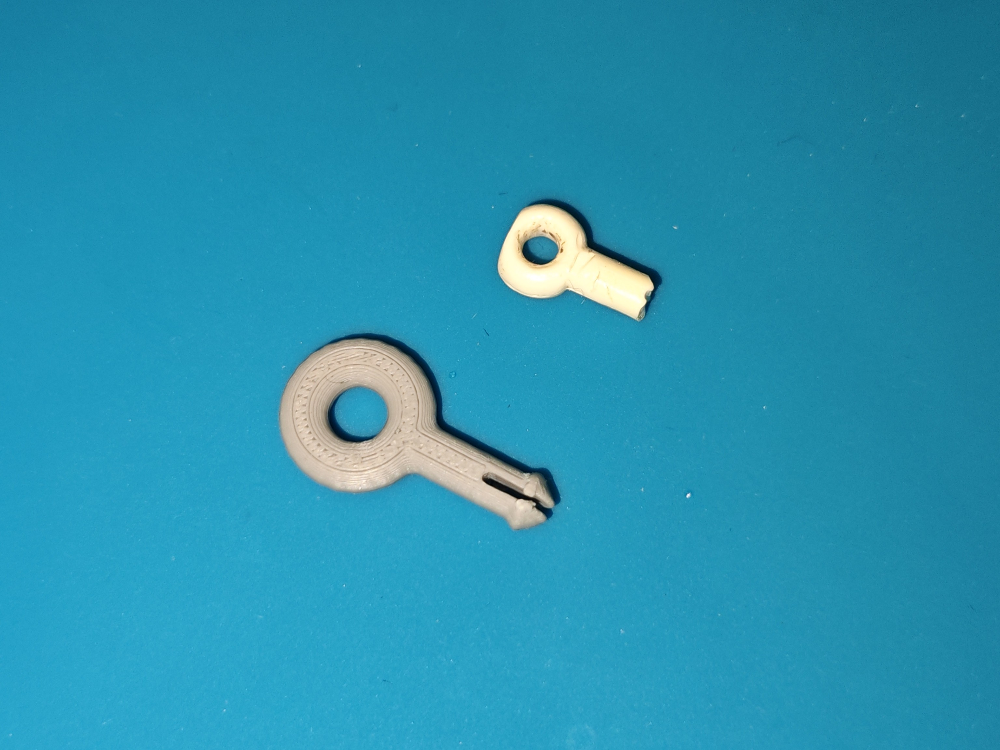
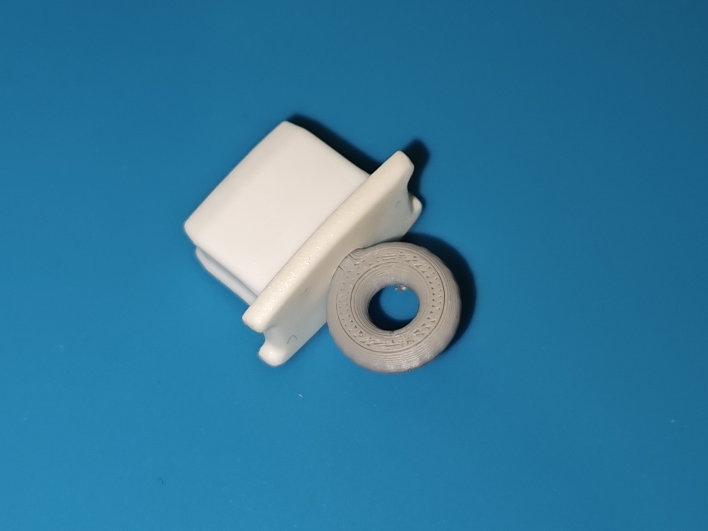
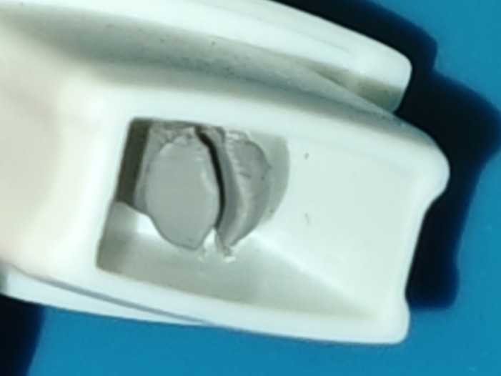
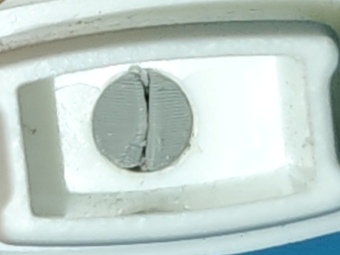
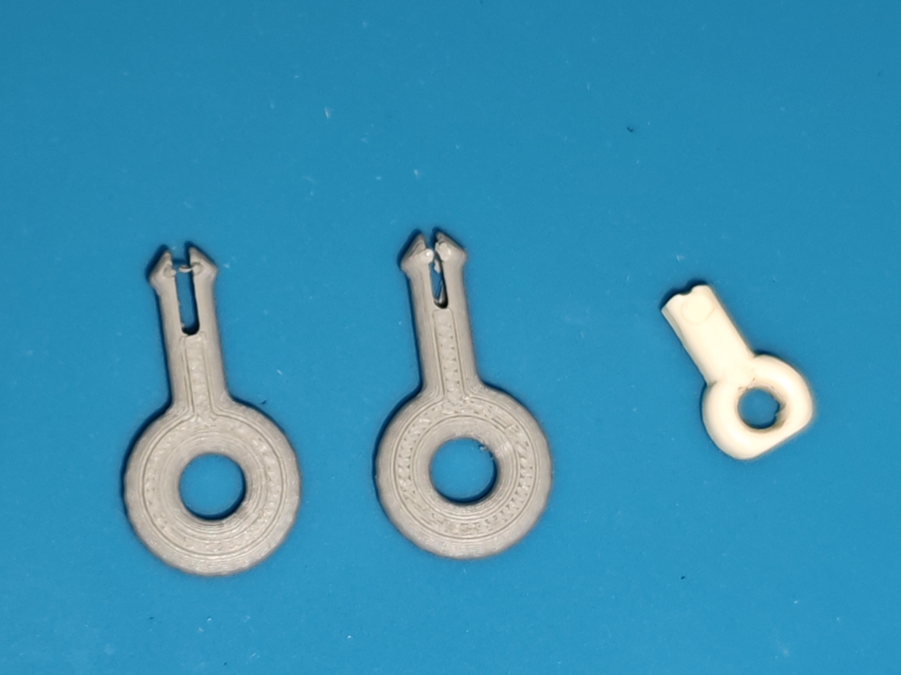

# Compliant-Pin-Mounting-Replacement

## Overview
This project is a reverse-engineered replacement for a failed factory mounting pin. The goal is to reproduce the original compliant mechanism while improving durability and ease of removal.

## The problem
The factory mounting pins broke due to mechanical stress. A replacement part was designed to replicate the original function while maintaining its compliant properties.

## Material
PLA was chosen for the initial design due to:
- low-cost
- ease of manufacturing
- good dimensional accuracy
- sufficient mechanical properties for compliant design
For the final version tougher materials such as ABS or NYLON may be considered.

### Printing
- Printer: Bambu Lab A1
- Nozzle: 0.2mm
- Layer height: 0.1mm
- Orientation: printed horizontally on its longest side to align layers with the expected tensile and shear stresses

### v0.1 Initial Prototype
Initial measurements were taken with digital calipers. The focus of the initial prototype is on replicating the compliant part.

The first prototype was undersized, multiple scaled versions were printed:

| Scale | Result |
|---|---|
| 120% | Too small |
| 125% | Optimal balance between fit and removability |
| 130% | Tighter fit |
| 135% | Secure connection but difficult to remove |
| 140% | Too large to fit |

Based on the tested scaling factors 125% was chosen as the most balanced option but 130% may be considered in the future.

#### Planned Changes
##### Removal Mechanism
The initial prototype required partial disassembly to remove. Planned improvements:
- Adding a ramp to the back side of the pin
- Lengthening the opening
##### Strength Improvements
- Narrowing the opening to improve strength as the additional compliance was found to be unnecessary
##### Mounting Interface
- Adding the mounting system.

### v1.0 Intermediary version, not tested
Added the back ramp to allow for easier removal.

### v1.1 First fully functional prototype

Added the line holder function as intended.

The reduced gap doesn't allow for sufficient compliance for easy removal, a larger one is needed.

#### Planned Changes
- Widen the gap to allow for easier addition and removal
- Make the pins shaft shorter to better match the original part in length

### v1.2 Final revision

The part is now perfectly functional. The hole is wide enough to allow for insertion and removal.

## Final Result

The v1.2 prototype successfully replaces the original mounting pin.

Improvements compared to the original:
- greatly improved retention compared to the original
- can be easily reproduced

The final design was printed using PLA, a tougher material may be considered if repeated removal and insertion is expected or sustained stress proves to be an issue.

#### Limitations

The final design was not yet subjucated to long term fatique testing.

## Files
/Images contains .jpg images showcasing the different revisions and changes
/3DFiles contains the .3mf files which can be used to print the select version
/cadFiles contains the .FCStd cad files which can be used to further edit or see the changes in each revision

## Tools used
- Bambu Lab A1 3d printer
- PLA plastic filament
- FreeCAD cad software
- Digital calipers
